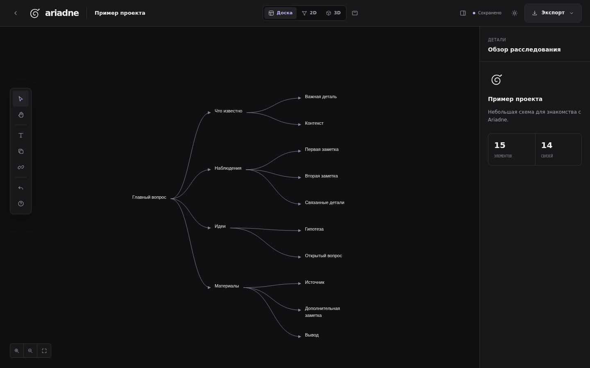

# ARIADNE

### Каждая деталь имеет значение.

**Свободная доска для OSINT-исследований, заметок и визуализации связей.**

[Открыть Ariadne](https://whiskeyfor.github.io/Ariadne/) · [Возможности](#возможности) · [Начало работы](#начало-работы) · [Хранение данных](#хранение-данных)

 

Доска Ariadne: один вопрос, несколько направлений и связи между деталями.

---

## От отдельных фактов — к общей картине

В исследовании важны не только сами детали, но и то, как они связаны. **Ariadne** помогает собрать заметки в одном пространстве, соединить их и посмотреть на получившуюся структуру в виде графа.

Здесь не нужно заранее выбирать тип для каждой записи. Просто добавляйте текст, располагайте элементы так, как удобно вам, и проводите связи.

> Ariadne — инструмент для организации информации. Он не выполняет автоматический поиск или проверку данных в интернете.

## Возможности

<table>
<tr><td width="50%">

**Свободная доска** 
Располагайте текст и заметки, соединяйте элементы линиями и стрелками. Добавляйте рамку только там, где она нужна.

</td><td width="50%">

**2D- и 3D-графы** 
Переключайтесь между представлениями, чтобы увидеть связи под другим углом. Масштаб и отображение графов можно настроить.

</td></tr>
<tr><td>

**Отдельные проекты** 
Создавайте отдельные пространства для разных тем. Пример проекта поможет познакомиться с интерфейсом.

</td><td>

**Импорт и экспорт** 
Сохраняйте резервные копии проектов в JSON или экспортируйте изображение доски в PNG.

</td></tr>
</table>

Также доступны светлая и тёмная темы, копирование элементов, отмена действий и выравнивание на доске.

## Начало работы

**В браузере**

1. Откройте **[Ariadne](https://whiskeyfor.github.io/Ariadne/)** — регистрация не требуется.
2. Перейдите к проектам и откройте пример или создайте новый.
3. Дважды нажмите на пустое место доски, чтобы добавить текст.
4. Соедините элементы, перетащив маркер от одного к другому.
5. Переключитесь на **2D** или **3D**, чтобы изучить граф связей.

**Локально**

Скачайте `index.html` из репозитория и откройте его в браузере. Установка зависимостей и сборка не нужны.

## Управление

| Действие | Клавиши |
| :--- | :--- |
| Копировать и вставить выбранный элемент | `Ctrl + C` → `Ctrl + V` / `⌘ + C` → `⌘ + V` |
| Дублировать элемент | `Ctrl + D` / `⌘ + D` |
| Отменить действие | `Ctrl + Z` / `⌘ + Z` |
| Временно отключить привязку при перемещении | Удерживать `Alt` |

Для копирования всего элемента сначала выделите его на доске. Если курсор находится в текстовом поле, копируется выделенный текст.

## Хранение данных

Проекты хранятся в **локальном хранилище браузера** на вашем устройстве. Аккаунтов, облачной синхронизации и совместной работы в Ariadne нет.

- Доски не переносятся автоматически между устройствами, браузерами или разными адресами сайта.
- При очистке данных браузера сохранённые проекты могут быть удалены.
- Для резервной копии и переноса используйте **экспорт и импорт JSON**.
- В некоторых ограниченных режимах браузера локальное хранилище может быть недоступно; тогда данные сохраняются только на время сессии.

> **Важно:** проект не проходил полноценный аудит безопасности. Не храните в нём пароли, токены и особо чувствительные данные.

## Для чего подойдёт

- собрать заметки и источники для исследования;
- наглядно разложить гипотезы и связи между ними;
- структурировать идеи, сложную тему или личный проект;
- рассмотреть одну и ту же схему на доске и в графах.

---

**Ariadne** · Следуйте за связями, не теряя нить.

[Открыть сайт](https://whiskeyfor.github.io/Ariadne/)

